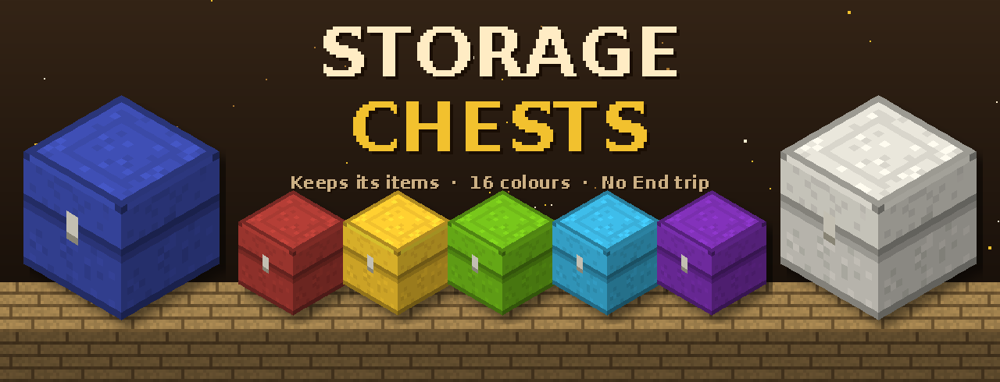
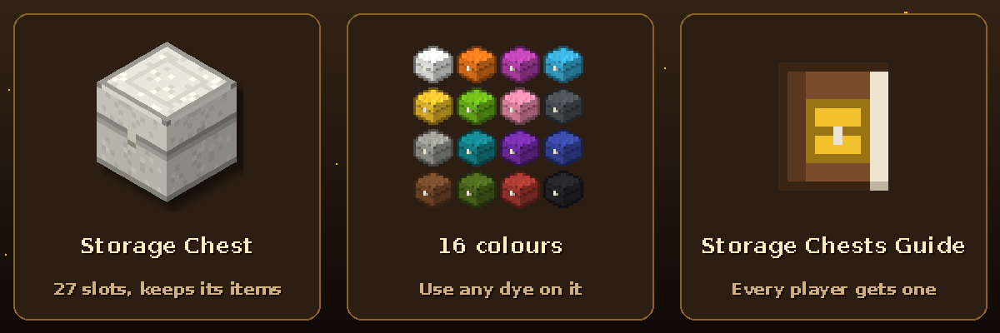
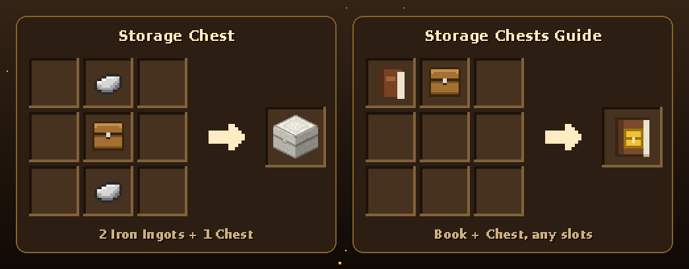

<p align="center">
  
</p>

<p align="center">
  <a href="https://github.com/sculley/storage-chests/releases/latest"></a>
  <a href="https://github.com/sculley/storage-chests/actions/workflows/release.yml"></a>
  
  
</p>

**Storage Chests** is a lightweight Minecraft Bedrock add-on that works like shulker boxes, without the trip to the End. A **Storage Chest** holds **27 stacks**, and when you pick it up **everything inside comes with it**. Dye it any of **16 colours** to colour-code your storage.

No experimental toggles. Works on every Bedrock platform, including console via Realms.

<p align="center">
  
</p>

## ⬇️ Download

Grab **`Storage_Chests-x.y.z.mcaddon`** from the [latest release](https://github.com/sculley/storage-chests/releases/latest).

## ✨ Features

- **Keeps its items**: hit a placed chest and it drops as an item with everything still inside. Place it again and every item is back where you left it, enchantments and names included.
- **Easy to craft**: two iron ingots and a chest. No shulker shells, no End city.
- **27 slots**: the same size as a chest or a shulker box.
- **16 colours**: use any dye on a placed chest to colour it, and a water bucket to wash it back. The colour stays when you pick it up.
- **Tough**: storage chests don't burn, can't be blown up and aren't pushed by pistons. You can stand on them.
- **No nesting**: a storage chest can't be carried inside another one. If you pick one up with another inside, the inner one pops out.
- **Storage Chests Guide**: every player gets one on first join. It explains everything, including the recipes, in-game.

## 🎮 How to play

| Action | How |
|---|---|
| Place a chest | Hold it and use it on a block. |
| Open it | Use the placed chest. |
| Pick it up | Hit it once. It drops with its items inside. |
| Dye it | Hold a dye and use it on the placed chest. |
| Remove the colour | Use a water bucket on it. The water isn't used up. |
| Read the guide | Hold the **Storage Chests Guide** and press use. |

**Use** on each device:

| PS5 / controller | PC | Touch |
|---|---|---|
| L2 | Right-click | Tap |

A carried chest's description shows how many stacks are inside.

## 🛠️ Recipes

All crafted on a crafting table. Everything is also in the creative inventory (Items tab), and the recipes are in the guide in-game.

<p align="center">
  
</p>

Dye chests once they're placed, not in the crafting grid.

## 📦 Installing

### Windows / Android / iOS
1. Download the `.mcaddon` and open it. Minecraft imports both packs.
2. Create or edit a world → **Behavior Packs** → activate **Storage Chests**. The resource pack is added automatically.

### PS5, Xbox and Switch
Consoles can't import add-on files directly, so bring the add-on in with a world:
1. Import the `.mcaddon` on a phone, tablet or PC and create a world with it active.
2. Upload that world to your **Realm** (Realm settings → *Replace world*).
3. Join the Realm from your console. The packs download automatically.

You can also host the world on a phone or PC and join it from your console as a friend.

> Like all add-ons, Storage Chests turns off achievements for the world it's enabled in.

## 🧑‍💻 Development

```
Storage_Chests_BP/               behaviour pack
  entities/storage_chest.json    the placed chest: 27-slot inventory, colour property
  items/ recipes/                17 chest items (undyed + 16 colours), the guide, recipes
  scripts/main.js                wires game events to the features below
  scripts/chest.js               placing, picking up (with contents) and dyeing
  scripts/colours.js             the 17 colours and their item IDs
  scripts/guide.js               the guide book and first-join gift
Storage_Chests_RP/               resource pack: model, textures, names, icon
tools/                           build script and artwork generators
docs/images/                     README artwork
```

Built on the stable Script API: `@minecraft/server` 2.9.0 and `@minecraft/server-ui` 2.1.0.

**How it works**
- **A placed chest is an entity.** Custom blocks can't hold items in Bedrock, so the chest is a block-sized entity with a 27-slot `minecraft:inventory`. It sits on the ground like a block, can be stood on (`minecraft:is_collidable`), and ignores all damage, fire, explosions and pistons.
- **Picking up:** hitting it (`world.afterEvents.entityHitEntity`) saves the chest entity, with its inventory, into a structure using `world.structureManager`. The structure's name is stored on the dropped item as a dynamic property (`stc:contents`), and the chest is removed. Structures keep items exactly, so nothing about them is lost.
- **Placing:** the item's `stc:storage_chest` custom component (`onUseOn`) places the structure back on the block face you used it on, then deletes the structure. An empty chest item just spawns a new chest.
- **Colours:** one entity with an int property `stc:colour` (0 = undyed, 1–16 = dye order). The render controller picks the texture from it. Each colour has its own item so a carried chest shows its colour.
- **Dyeing:** `world.beforeEvents.playerInteractWithEntity` cancels the inventory opening when you're holding a dye or water bucket, and sets the colour instead.

**Build locally**

```bash
python tools/build.py          # → dist/Storage_Chests-<manifest version>.mcaddon
python tools/build.py 1.2.0    # stamp a specific version into the package
```

**Regenerate artwork and variants** (needs Pillow and the DejaVu fonts)

```bash
python tools/render_textures.py   # chest textures, item icons and pack icons
python tools/make_variants.py     # the 17 item files, item_texture.json, client entity and names
python tools/render_docs.py       # README images
```

**Customise**
- Colours: edit `COLOURS` in `tools/render_textures.py` and `scripts/colours.js` (keep the same order), then run the two tools above.
- Recipe: `Storage_Chests_BP/recipes/storage_chest.json`.

**Release:** push a version tag and GitHub Actions validates the packs, builds the `.mcaddon` and `.mcpack` files, and attaches them to a new release:

```bash
git tag v1.0.0
git push origin v1.0.0
```

Every push and pull request is also built, with the files available as a workflow artifact.

---

<sub>All textures and artwork are original and generated by the scripts in <code>tools/</code>. Not affiliated with Mojang or Microsoft.</sub>
